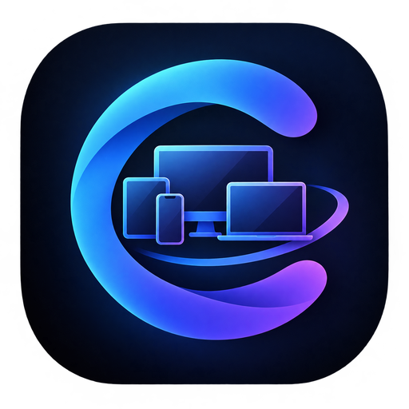
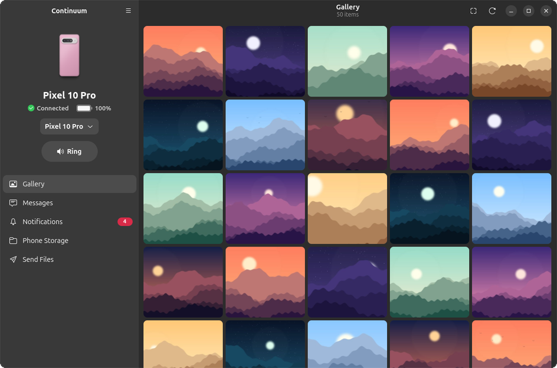
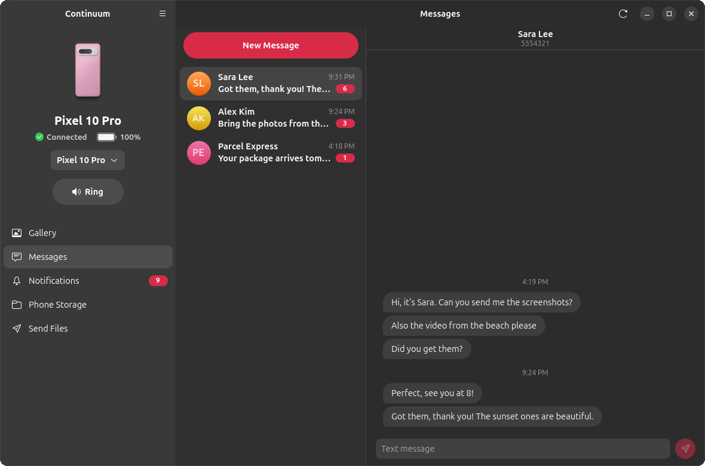
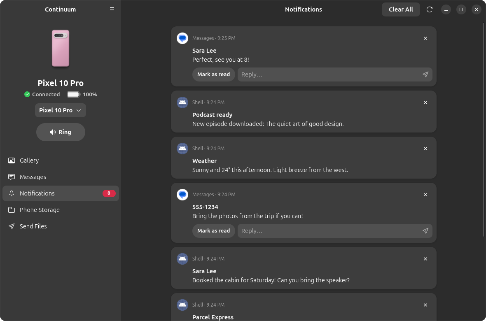
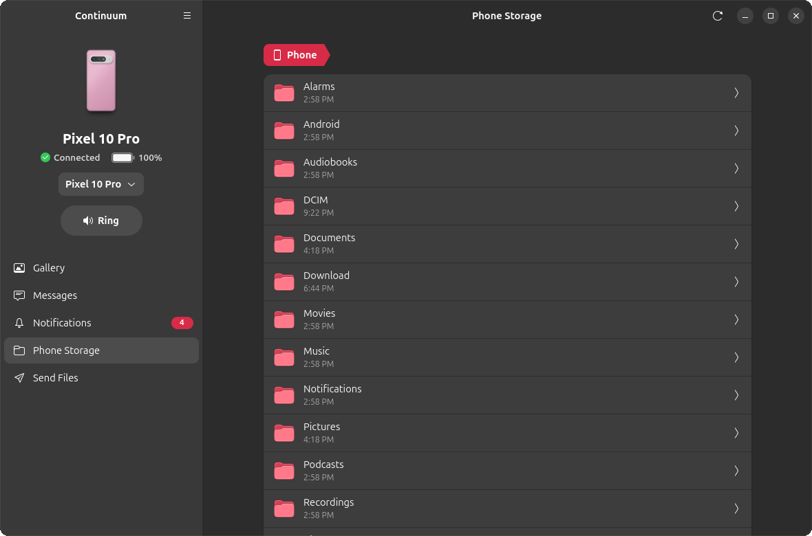
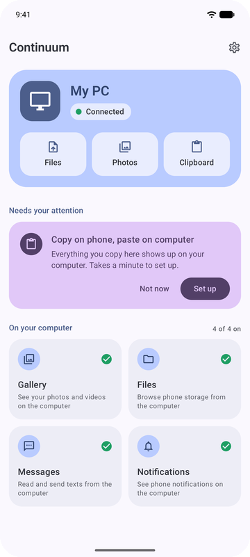
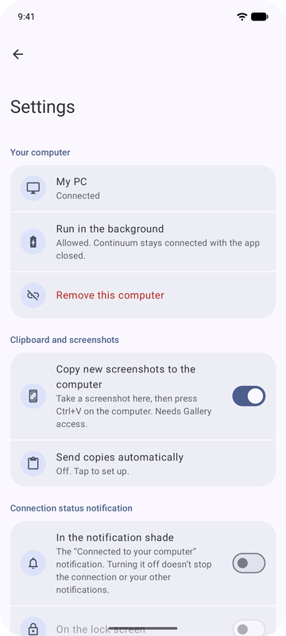
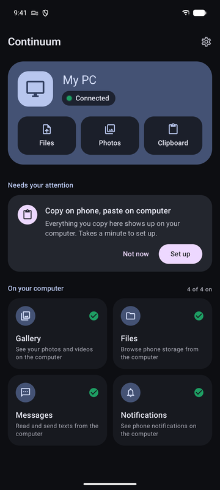
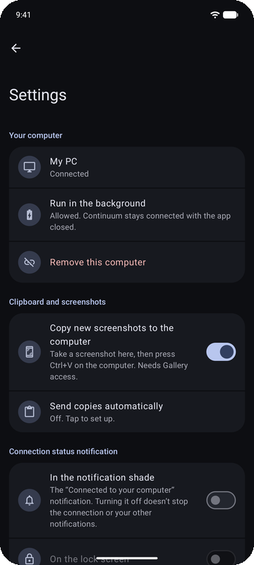

<p align="center"></p>

<h1 align="center">Continuum</h1>

<p align="center"><b>Your Android phone, at home on Linux.</b><br>
Photos, messages, notifications, files and one clipboard between your phone and your GNOME desktop.<br>
Like Phone Link and Apple Continuity, but open source and private: no cloud, no account.</p>

<p align="center">
  <a href="https://github.com/sharjeelmazhar/continuum/releases"></a>
  <a href="https://github.com/sharjeelmazhar/continuum/actions/workflows/ci.yml"></a>
  <a href="LICENSE"></a>
  <a href="https://sharjeelmazhar.github.io/continuum/"></a>
</p>

<p align="center"></p>

## Screenshots

**On the desktop** (GTK 4 + libadwaita)

| Messages | Notifications with quick reply | Phone storage |
|---|---|---|
|  |  |  |

**On the phone** (Jetpack Compose, light and dark)

| Home | Settings | Home (dark) | Settings (dark) |
|---|---|---|---|
|  |  |  |  |

## Features
- 🖼️ **Gallery.** Your photos and videos, with videos playing in the app. Select several and copy them straight into Files or a chat.
- 💬 **Messages.** SMS conversations with contact photos; reply from your PC keyboard, with typing help.
- 🔔 **Notifications** from the phone, with quick reply and their own buttons. Dismiss on the PC and it's gone from the phone.
- 📁 **Phone storage.** Browse every folder on the phone and download any file, no cable needed.
- ⚡ **Send files both ways** at full Wi-Fi speed, with progress on both sides: the PC is in the Android
  share sheet, and "Send to ⟨phone⟩" is in the Files right-click menu.
- 📋 **Shared clipboard.** Copy on one device, paste on the other. Phone screenshots land straight on the PC's clipboard.
- 🎛️ **GNOME Quick Settings tile** with the phone's battery, connection and Ring.
- 🔊 **Find my phone.** Ring it at full volume, even on silent.
- 🔋 **Battery** level, charging speed and time until full.
- 🗂️ **Separate notification categories** on the phone, so you pick which Continuum alerts you see.
- 🌿 **Battery-friendly.** An adaptive connection: responsive while you use it, nearly idle when you don't. Reconnects by itself.

Coming next: calls with an incoming-call banner, phone mirroring, a per-app notification
allowlist and media controls. See the [roadmap](docs/ROADMAP.md).

## Install

### Computer (Linux with GNOME)
```sh
curl -fsSL https://sharjeelmazhar.github.io/continuum/install.sh | sh
```
Works on Ubuntu, Debian, Linux Mint, Pop!_OS, Fedora, Arch, Manjaro and EndeavourOS with GNOME,
on 64-bit PCs (x86_64). Tested on Ubuntu 26.04, Fedora 45 and Arch with GNOME 50 and 51.

The script adds Continuum's signed package repository and installs the app plus a background
service that starts at login. Run it as yourself (not with `sudo`); it asks for your password when
needed. **Updates** then arrive with the system's own updates: GNOME Software, `sudo apt upgrade`,
`sudo dnf upgrade` or `sudo pacman -Syu`.

### Phone (Android 10 or newer)
Download the APK from [Releases](https://github.com/sharjeelmazhar/continuum/releases) and install it.
The app **updates itself** from GitHub Releases; no Play Store needed.

## Pair in 3 steps
1. Open **Continuum** on the computer and click **Pair a Phone**.
2. Open **Continuum** on the phone.
3. Scan the QR code. Done.

From then on nothing needs to be opened: both sides reconnect automatically whenever they're on
the same network, including after reboots.

## Build from source
```sh
git clone https://github.com/sharjeelmazhar/continuum.git && cd continuum
scripts/setup-dev.sh --no-avd     # toolchains (Ubuntu/Debian; drop --no-avd to also get an emulator)
scripts/install-desktop.sh        # builds and installs the desktop app and its service for your user
```
The desktop is a Cargo workspace in `desktop/` (Rust, tokio, rustls, GTK 4 + libadwaita); the
Android app is a Gradle project in `android/` (Kotlin, Jetpack Compose). Run `cargo test` and
`cargo clippy -- -D warnings` in `desktop/`, and `./gradlew test assembleDebug` in `android/`.
See [docs/ARCHITECTURE.md](docs/ARCHITECTURE.md).

## Security
- Every connection is **TLS 1.3 with mutually pinned device certificates**, set when you pair by QR code.
- Phone and computer talk **directly on your own network**. Nothing leaves it: no cloud, no account, no telemetry.
- Every incoming message is treated as untrusted: size limits, strict parsing, safe file names.

Details in [docs/PROTOCOL.md](docs/PROTOCOL.md).

## Roadmap
Calls (M8), phone mirroring (M9), KDE Plasma support and more: see [docs/ROADMAP.md](docs/ROADMAP.md)
and the current status in [PROGRESS.md](PROGRESS.md).

## License
GPL-3.0-or-later. See [LICENSE](LICENSE).
