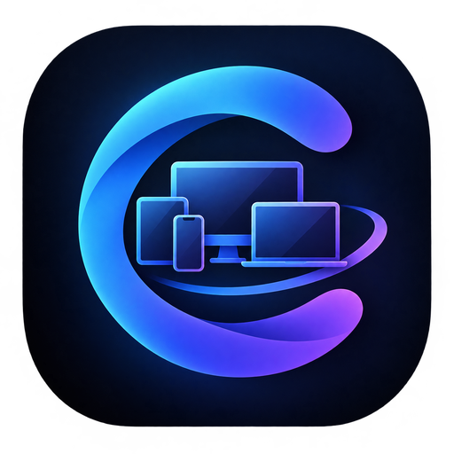

# Continuum

**An Apple-Continuity-style ecosystem for Android phones and Linux desktops.**
It's fast, private (everything stays on your LAN, end-to-end encrypted) and designed to feel modern.

> Status: early development. **Working today:** pairing by QR code, an always-on encrypted
> connection that reconnects by itself, and the phone's battery on the PC.
> See [PROGRESS.md](PROGRESS.md) and [docs/ROADMAP.md](docs/ROADMAP.md).

## Try it
1. **Computer** (any Linux distro with GNOME, for now from source):
   `git clone https://github.com/sharjeelmazhar/continuum && cd continuum && scripts/setup-dev.sh --no-avd && scripts/install-desktop.sh`
   This installs the app and a background service that starts at login.
2. **Phone:** download the APK from [Releases](https://github.com/sharjeelmazhar/continuum/releases) and install it.
3. Open **Continuum** on the computer, click **Pair a Phone**, and scan the code with the app.

After that, nothing needs to be opened: both sides reconnect automatically whenever they're
on the same network, including after reboots.

## Planned features
- 📤 **AirDrop-style sharing.** Your PC appears in the Android share sheet with its own icon,
  and "Send to ⟨phone⟩" is in the file manager's right-click menu.
- 📋 **Universal clipboard.** Copy text or images on one device and paste them on the other, automatically.
- 🔔 **Notifications** from the phone apps you choose, with quick reply.
- 📞 **Calls.** An elegant incoming-call banner on the PC with accept and decline.
- 📱 **Phone mirroring.** Your phone in a borderless, rounded window that you control with
  your mouse and keyboard.
- 🔋 Battery status, find my phone and media controls. Later: the phone as webcam and mic, and SMS.

## Platforms
- Desktop: Linux, GNOME (Wayland and X11) first. Written in Rust + GTK4/libadwaita.
- Android 10+ today (Android 8–9 support is planned), tested up to Android 17. Written in Kotlin + Jetpack Compose.

## Security
TLS 1.3 with mutually pinned device certificates, pairing by QR code or a verified 6-digit
code, and no cloud or account. See [docs/PROTOCOL.md](docs/PROTOCOL.md).

## License
GPL-3.0-or-later. See [LICENSE](LICENSE).
