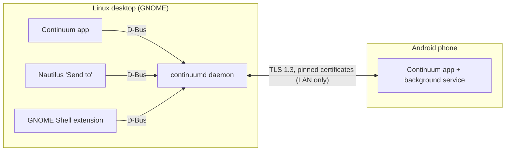

# Software Requirements Specification (SRS)

| | |
|---|---|
| Product | Continuum |
| Version of this document | 1.0 (29 October 2026) |
| Status | Baseline. Change it with a PR that also updates the affected design docs and ADRs. |

## 1. Introduction

### 1.1 Purpose
This document says **what** Continuum must do and how good it has to be. It doesn't say how
it's built: that's in [`design/`](design/README.md), and the reasons for big choices are in
[`adr/`](adr/README.md). Every requirement has an ID (`FR-…`, `NFR-…`) so that design docs,
tests and commits can point to it.

### 1.2 Scope
Continuum links an **Android phone** and a **Linux desktop** on the same network, so they work
together the way an iPhone and a Mac do: send files, share the clipboard, see notifications and
calls, and mirror the phone screen. It replaces KDE Connect / GSConnect for GNOME users with a
faster, more secure and more polished experience.

Out of scope for now: iOS, Windows, macOS, cloud relays (traffic over the internet), and
accounts or sign-in of any kind.

### 1.3 Definitions
| Term | Meaning |
|---|---|
| Device | One install of Continuum (a phone or a desktop). |
| Peer | The other device in a connection. |
| Pairing | The one-time step where two devices learn to trust each other. |
| Fingerprint | SHA-256 of a device's certificate. It identifies the device and can't be faked. |
| Pinning | Remembering a peer's fingerprint and refusing any other. |
| Plugin | One feature (files, clipboard, notifications…) on both sides of the connection. |
| Daemon | `continuumd`, the background program on the desktop that does the actual work. |
| SAS | Short Authentication String: a 6-digit code both screens show, which the user compares. |
| Shizuku | A free Android app that lets other apps use ADB-level permissions without root. |

### 1.4 References
[ROADMAP](ROADMAP.md) · [ARCHITECTURE](ARCHITECTURE.md) · [PROTOCOL](PROTOCOL.md) ·
[design docs](design/README.md) · [ADRs](adr/README.md)

## 2. Overall description

### 2.1 Product perspective
Two apps that talk directly over the local network, with no server in between:

### 2.2 Users
| User | Description | What they need |
|---|---|---|
| Everyday user | Not technical. Uses GNOME and an Android phone. | Install, scan a QR code, done. No terminal, IP addresses or config files. |
| Power user | Comfortable with settings. | Optional extras (e.g. Shizuku for background clipboard), with guided setup. |
| Contributor | Developer. | Clear docs, modular code, tests that run with one command. |

### 2.3 Operating environment
- Desktop: Linux with GNOME 46 or newer, Wayland first (X11 should work but is not a priority).
  Ubuntu/Debian and Fedora are the reference distros.
- Phone: Android 8.0 (API 26) or newer. Some features need newer versions (noted per requirement).
- Network: both devices on the same LAN or Wi-Fi with multicast (mDNS) allowed. If mDNS is
  blocked, the QR code still carries the address, so pairing and connecting keep working.

### 2.4 Constraints
- C-1: Open source under GPL-3.0-or-later. The repo is public, so no personal data in it.
- C-2: Desktop in Rust with GTK4 + libadwaita. Android in Kotlin + Jetpack Compose ([ADR-0002](adr/0002-desktop-rust-gtk4.md), [ADR-0003](adr/0003-android-kotlin-compose.md)).
- C-3: Must run side by side with KDE Connect during migration (no port or mDNS name clashes).
- C-4: The desktop PC can lose power at any moment. Nothing may be left corrupted by that.

### 2.5 Assumptions
- The user owns both devices and can physically see both screens during pairing.
- The LAN is **not** trusted: other people on the same Wi-Fi may be hostile.

## 3. Functional requirements

Priority: **M** = must (needed for the feature to ship), **S** = should, **C** = could.
Milestone = where it gets built (see ROADMAP).

### 3.1 Discovery and connection (M1, M2)
| ID | Requirement | Pri |
|---|---|---|
| FR-CON-1 | Each device creates its own identity (key + certificate) on first run, without asking the user. | M |
| FR-CON-2 | Devices find each other on the LAN automatically (mDNS). | M |
| FR-CON-3 | Paired devices reconnect automatically when both are on the same network, within 5 s of becoming reachable. | M |
| FR-CON-4 | A dropped connection is retried with backoff. The user never has to press "reconnect". | M |
| FR-CON-5 | The phone keeps the connection alive in the background (foreground service) and survives the phone's battery optimization where Android allows it. | M |
| FR-CON-6 | The desktop shows whether each paired device is connected, and its battery level. | S |

### 3.2 Pairing (M3)
| ID | Requirement | Pri |
|---|---|---|
| FR-PAIR-1 | The desktop shows a QR code. Scanning it on the phone pairs both devices with no typing. | M |
| FR-PAIR-2 | Fallback without a camera: pick the device from a list, and both screens show the same 6-digit code to confirm. | M |
| FR-PAIR-3 | A QR code works only once and expires after 2 minutes. | M |
| FR-PAIR-4 | Devices exchange a name and type (phone, tablet, laptop, desktop), which decides the icon shown everywhere. | M |
| FR-PAIR-5 | The user can rename or unpair a device from either side. Unpairing deletes the pinned certificate. | M |
| FR-PAIR-6 | Unpaired devices can't do anything except ask to pair. | M |

### 3.3 Files (M4, M5)
| ID | Requirement | Pri |
|---|---|---|
| FR-FILE-1 | Each paired PC appears in the Android share sheet as its own entry, with its name and a laptop or desktop icon. | M |
| FR-FILE-2 | Several files can be sent at once, in parallel. | M |
| FR-FILE-3 | The desktop shows progress, then a notification with "Open" and "Show in folder". Files go to `~/Downloads/Continuum/` by default. | M |
| FR-FILE-4 | Interrupted transfers (Wi-Fi drop, app killed, power loss) resume from the last verified byte. | M |
| FR-FILE-5 | Each file is checked with SHA-256 before it's shown as finished. Partial files are never shown as complete. | M |
| FR-FILE-6 | Nautilus right-click → "Send to ⟨device⟩", one entry per paired device, with its icon. | M |
| FR-FILE-7 | Drag and drop files onto the Continuum window to send them. | S |
| FR-FILE-8 | Files received on the phone go to `Download/Continuum` and raise a notification that opens them. | M |

### 3.4 Clipboard (M6)
| ID | Requirement | Pri |
|---|---|---|
| FR-CLIP-1 | Copied text on one device can be pasted on the other, in both directions. | M |
| FR-CLIP-2 | Images too. | S |
| FR-CLIP-3 | Fully automatic on the desktop. On the phone, automatic when Shizuku or an ADB grant is set up (Android 10+ blocks it otherwise), with a guided in-app setup. | M |
| FR-CLIP-4 | Without Shizuku, a Quick Settings tile and a share-sheet action send the clipboard manually. | M |
| FR-CLIP-5 | No echo loops: content that just came from the peer isn't sent back. | M |
| FR-CLIP-6 | Content marked sensitive (e.g. by password managers) isn't synced by default. | S |

### 3.5 Notifications (M7)
| ID | Requirement | Pri |
|---|---|---|
| FR-NOTIF-1 | Phone notifications from **allowlisted apps only** appear on the desktop as native GNOME notifications, with the app's icon. | M |
| FR-NOTIF-2 | The allowlist is empty by default. It's editable from both devices. | M |
| FR-NOTIF-3 | Reply from the desktop to messaging apps that support quick reply. | M |
| FR-NOTIF-4 | Dismissing on one device dismisses on the other. | S |

### 3.6 Calls (M8)
| ID | Requirement | Pri |
|---|---|---|
| FR-CALL-1 | An incoming call shows an iOS-style banner on the desktop with the caller's name and photo. | M |
| FR-CALL-2 | Accept, decline and silence from the desktop. | M |
| FR-CALL-3 | Missed calls appear as notifications. | S |

### 3.7 Mirroring (M9)
| ID | Requirement | Pri |
|---|---|---|
| FR-MIR-1 | Show the phone screen in a borderless window with rounded corners shaped like the phone. | M |
| FR-MIR-2 | Control the phone with the PC's mouse and keyboard (needs Shizuku). | S |
| FR-MIR-3 | Controls (close, rotate, screenshot, home, back) fade in on hover. | S |

### 3.8 Settings and integration (M10)
| ID | Requirement | Pri |
|---|---|---|
| FR-SET-1 | Each feature can be switched on or off per device. | M |
| FR-SET-2 | GNOME quick-settings tile: connection state, battery, send clipboard, mirror. | S |
| FR-SET-3 | Find my phone: ring at full volume, even when silenced. | S |
| FR-SET-4 | Media controls for what's playing on the phone. | C |
| FR-SET-5 | The daemon starts automatically at login (systemd user service). | M |

## 4. Non-functional requirements

### 4.1 Security and privacy
| ID | Requirement |
|---|---|
| NFR-SEC-1 | Everything on the network is encrypted with TLS 1.3. No plaintext mode exists. |
| NFR-SEC-2 | After pairing, each side accepts only the pinned peer certificate. A mismatch closes the connection and warns the user. |
| NFR-SEC-3 | No trust without the user confirming (QR scan or matching code). |
| NFR-SEC-4 | Every incoming message is treated as hostile: size limits (1 MiB control frames), strict parsing, unknown fields ignored safely. |
| NFR-SEC-5 | Received file names are sanitized: no path traversal, control characters or over-long names. |
| NFR-SEC-6 | Private keys are stored with owner-only permissions (`0600`) on the desktop and in the Android Keystore on the phone. |
| NFR-SEC-7 | Pairing attempts are rate-limited (5 failures per minute per address). |
| NFR-SEC-8 | No analytics, telemetry or cloud. Data never leaves the two devices. |

### 4.2 Performance
| ID | Requirement |
|---|---|
| NFR-PERF-1 | File transfer reaches at least 80% of the link's measured TCP throughput. |
| NFR-PERF-2 | Clipboard text arrives on the other device within 500 ms. |
| NFR-PERF-3 | Notifications and call banners appear within 1 s, even during a large transfer. |
| NFR-PERF-4 | Mirroring latency under 60 ms on a typical 5 GHz Wi-Fi LAN. |
| NFR-PERF-5 | Idle daemon: under 30 MB RAM and near-zero CPU. Idle phone service: negligible battery drain (no polling, push only). |

### 4.3 Reliability
| ID | Requirement |
|---|---|
| NFR-REL-1 | Power loss at any moment leaves no corrupt state: config and keys are written atomically (temp file, then rename). |
| NFR-REL-2 | Transfers resume after any interruption (see FR-FILE-4). |
| NFR-REL-3 | A crash in one feature must not take down the connection or the other features. |

### 4.4 Usability
| ID | Requirement |
|---|---|
| NFR-USE-1 | First pairing takes under 1 minute, with no terminal, IP address or config file. |
| NFR-USE-2 | The desktop UI follows the GNOME Human Interface Guidelines (libadwaita). The phone UI follows Material 3. |
| NFR-USE-3 | All user-facing text is plain language. Errors say what to do next. |
| NFR-USE-4 | Optional power-user setup (Shizuku, battery whitelisting) has a guided flow with a clear fallback. |
| NFR-USE-5 | Light and dark themes, and screen-reader labels on all controls. |

### 4.5 Maintainability and portability
| ID | Requirement |
|---|---|
| NFR-MNT-1 | One plugin per feature on both sides. Adding a feature mustn't require changes to the core. |
| NFR-MNT-2 | The protocol crate has no network I/O, so it can be tested without sockets. |
| NFR-MNT-3 | CI runs format, lint (clippy `-D warnings`) and tests for both platforms on every push. |
| NFR-MNT-4 | Protocol changes are versioned. A newer peer never breaks an older one (capability negotiation). |
| NFR-MNT-5 | The daemon is desktop-agnostic. GNOME-specific code lives only in the UI and extensions, so KDE or wlroots front-ends can be added later. |

## 5. Verification
| Kind | What | Where |
|---|---|---|
| Unit | Parsing, crypto, state machines | `cargo test`, JUnit |
| Property / fuzz | Frame parser, file-name sanitizer | proptest, cargo-fuzz (M11) |
| Integration | Two in-process peers handshake, pair, transfer | `continuumd` tests |
| Interop | Daemon on the PC ↔ app on the Android emulator | `scripts/emulator.sh` + test scripts |
| Manual | UI flows on a real phone | Checklist in each milestone's PR |

Each design doc lists the requirement IDs it covers. A requirement is done when the test that
proves it passes.

## 6. Open questions
| # | Question | Owner decision needed? |
|---|---|---|
| Q-1 | Final app ID / package name. **Resolved:** `io.github.sharjeelmazhar.Continuum`, see ADR-0013. | Done |
| Q-2 | Support more than one phone per desktop in v1, or later? (Design allows it; UI assumes one for now.) | Later |
