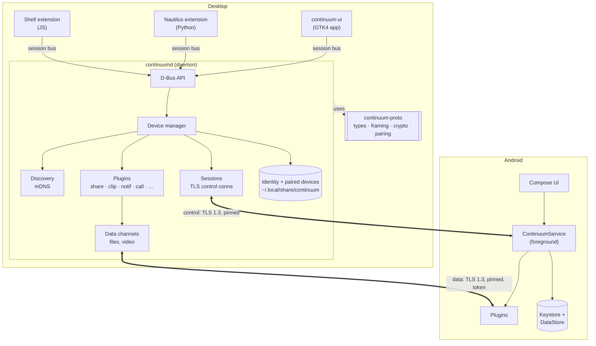
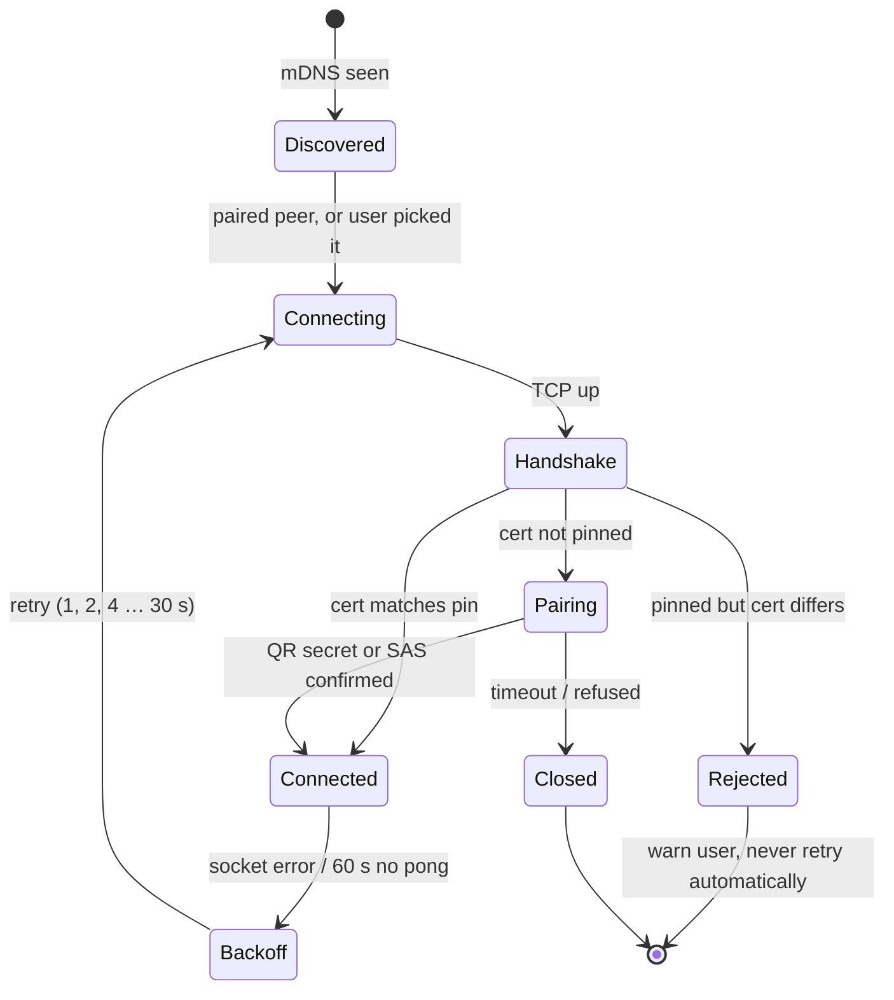
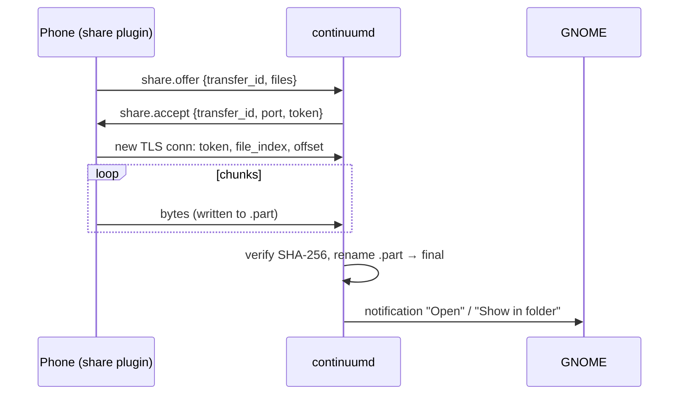

# 00. System overview

Covers: FR-CON-*, NFR-MNT-1, NFR-MNT-5, NFR-REL-3. Decisions: ADR-0004, 0005, 0007, 0008.

## Components

**Layering rule:** `continuum-proto` knows nothing about sockets, GTK or D-Bus. `continuumd`
knows nothing about GTK or GNOME. GNOME-specific code is in the UI and extensions only. This is
what keeps the system easy to change (NFR-MNT-5).

## Connection lifecycle

## A typical exchange (phone sends a file)

## Concurrency model
- **Desktop:** one tokio runtime in `continuumd`. One task per connection. Plugins receive
  messages over channels, so a slow or panicking plugin can't block the connection (NFR-REL-3).
  The GTK app has its own main loop and only talks D-Bus.
- **Android:** the foreground service owns a coroutine scope. One coroutine per connection,
  `SupervisorJob` so one plugin's failure doesn't cancel the others.

## Persistence
| Data | Desktop | Android |
|---|---|---|
| Private key | `~/.local/share/continuum/identity/` (`0600`) | Android Keystore |
| Paired devices (name, type, pinned fingerprint, settings) | `devices.toml`, atomic write | DataStore |
| Partial transfers | `<dest>/.name.part` + `.name.part.json` (verified offset) | app cache dir |
