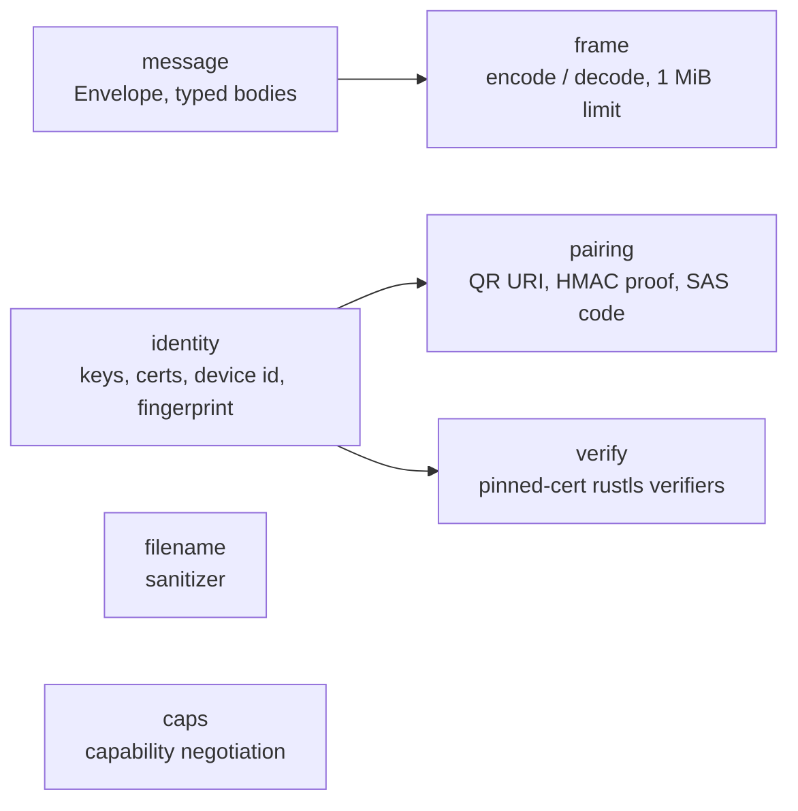

# 01. continuum-proto (wire protocol library)

Covers: NFR-SEC-1…5, NFR-MNT-2, NFR-MNT-4. Decisions: ADR-0005, 0006, 0008. Spec: [PROTOCOL.md](../PROTOCOL.md).

## Purpose
Everything both sides must agree on, in one pure Rust library with **no network I/O**, so it can
be tested exhaustively without sockets. The daemon (and later other tools) build on it. The
Android app mirrors these types in Kotlin, and interop tests keep them identical.

## Modules

| Module | Responsibility | Key API (sketch) |
|---|---|---|
| `message` | `Envelope { id: u64, type: String, body: Value }` and typed bodies per plugin. Unknown fields are ignored, unknown types become `Unsupported`. | `Envelope::parse(&[u8])` |
| `frame` | Length-prefixed framing. Rejects frames over 1 MiB **before** allocating. Incremental decoder for partial reads. | `FrameDecoder::push(&[u8]) -> Result<Vec<Envelope>>` |
| `identity` | Generate key + self-signed cert. Device id = base32(SHA-256(pubkey)[..16]). Fingerprint = SHA-256(cert DER). | `Identity::generate()`, `.fingerprint()` |
| `verify` | rustls `ServerCertVerifier` / `ClientCertVerifier` that accept exactly the pinned fingerprint (or, during pairing, the fingerprint from the QR code). | `PinnedVerifier::new(fp)` |
| `pairing` | Build/parse `continuum://pair?...`, compute and check the HMAC proof, compute the 6-digit SAS. Constant-time comparisons. | `PairUri`, `sas_code(fp_a, fp_b, nonce)` |
| `filename` | Turn any peer-supplied name into a safe base name. | `sanitize(&str) -> String` |
| `caps` | Intersect capability lists from both `hello` messages. | `negotiate(&[Cap], &[Cap])` |

## Error handling
One `ProtoError` enum (`FrameTooLarge`, `BadJson`, `BadUri`, `ProofMismatch`, …). The caller
decides what to do. Every protocol error on a connection closes that connection. Nothing panics
on peer input: this is checked with property tests and, from M11, fuzzing.

## Tests
- Unit tests per module.
- **proptest:** any byte sequence fed to `FrameDecoder` either yields valid envelopes or an
  error, never a panic or an allocation above the limit. Frames split at every possible
  byte boundary decode identically.
- **filename:** `../`, absolute paths, NUL and control characters, Windows reserved names,
  names over 255 bytes, empty names, Unicode normalization.
- Known-answer tests for SAS and HMAC so the Kotlin side can reuse the same vectors
  (`continuum-proto/tests/vectors.json`).
