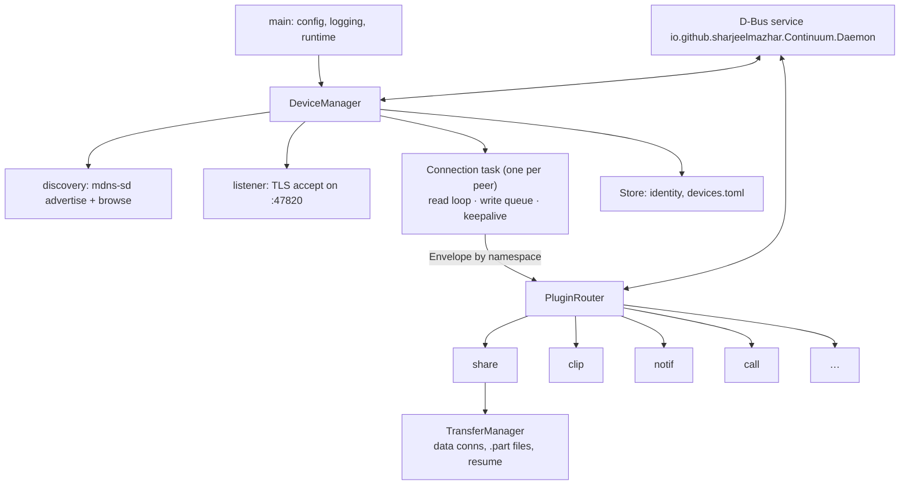

# 02. continuumd (desktop daemon)

Covers: FR-CON-*, FR-FILE-2…5, NFR-REL-*, NFR-PERF-1, NFR-PERF-5, FR-SET-5. Decisions: ADR-0004, 0007, 0008, 0011.

## Purpose
The always-running background program that owns the identity, the paired-device list, all
network connections and all transfers. It has no UI and exposes everything over D-Bus.

## Internal structure


## Plugin interface (sketch)
```rust
#[async_trait]
trait Plugin: Send + Sync {
    fn namespace(&self) -> &'static str;            // "share", "clip", …
    async fn on_connected(&self, peer: &PeerHandle);
    async fn on_message(&self, peer: &PeerHandle, msg: Envelope) -> Result<()>;
    async fn on_disconnected(&self, peer: &DeviceId);
}
```
`PeerHandle` lets a plugin send envelopes and open data channels, and nothing else. Each plugin
runs behind its own channel and task. An error is logged and reported as `error.*` to the peer,
but never closes the control connection unless it's a protocol violation.

## D-Bus API (first version)
Object `/io/github/sharjeelmazhar/Continuum/Daemon`, interface `io.github.sharjeelmazhar.Continuum.Daemon1`:

| Member | Kind | Purpose |
|---|---|---|
| `ListDevices() → a(ssssb)` | method | id, name, type, icon, connected |
| `StartPairing() → (s uri, u expires_s)` | method | QR content for the UI |
| `ConfirmSas(s id, b ok)` | method | user confirmed / rejected the code |
| `Unpair(s id)`, `Rename(s id, s name)` | method | device management |
| `SendFiles(s id, as paths)` | method | used by Nautilus and drag-and-drop |
| `DeviceChanged(s id)`, `PairingRequest(s id, s sas)`, `TransferProgress(s, t, t)` | signal | UI updates |

Plugins add their own interfaces (e.g. `io.github.sharjeelmazhar.Continuum.Clipboard1`) on per-device objects
`/io/github/sharjeelmazhar/Continuum/Device/<id>`. The interface name carries a version number so it can evolve.

## Reliability
- **Atomic writes** for config and identity: write `*.tmp`, `fsync`, rename, `fsync` the directory.
- **Transfers:** data goes to `.name.part`. A sidecar `.name.part.json` records the verified
  offset every 8 MiB. On resume the sender is asked to continue from that offset. The final
  hash is checked before the rename. Sidecars without a matching offer older than 7 days are
  cleaned up.
- **Reconnect:** exponential backoff 1 → 30 s, reset when mDNS sees the peer again.
- **Startup:** systemd user unit with `Restart=on-failure`. D-Bus activation as a fallback.

## Tests
- Two in-process daemons on loopback with temp dirs: pair, reconnect, reject a wrong cert.
- Transfer killed at random offsets, then resumed. The result is byte-identical.
- Plugin that panics: the connection survives and other plugins still work.
