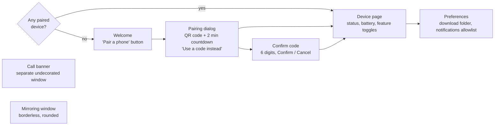

# 03. continuum-ui (desktop app)

Covers: FR-PAIR-1, 2, 4, 5, FR-FILE-3, 7, FR-CALL-1, FR-MIR-1, 3, FR-SET-1, NFR-USE-*. Decisions: ADR-0002, 0004.

## Purpose
The visible part on the desktop: pairing, the device list, settings, the call banner and the
mirroring window. It holds **no** connection state. Everything comes from `continuumd` over
D-Bus, so the window can be closed at any time.

## Screens

## Structure
- `app.rs`: `adw::Application`, single instance. Activation opens or raises the window.
- `daemon.rs`: zbus proxy for `io.github.sharjeelmazhar.Continuum.Daemon1`. Turns D-Bus signals into GLib main-loop
  events, so widgets are only touched on the GTK thread.
- `pages/`: one module per screen above. Each page is a GObject subclass with a Blueprint or
  builder UI and reads only from a view-model struct, so screens can be tested and changed
  independently.
- `banner/`, `mirror/`: own windows, added in M8 and M9.

## UX rules
- libadwaita widgets and spacing (GNOME HIG). Follows the system light or dark style and accent colour.
- Every error is a plain-language toast or status page with a next step ("Make sure both
  devices are on the same Wi-Fi").
- If the daemon isn't running, the app starts it (D-Bus activation) and shows a spinner, not an error.

## Tests
- View-model unit tests (no display needed).
- Smoke test in CI: launch under a headless display and check that the window appears and closes.
- Manual checklist per milestone for visual polish.
