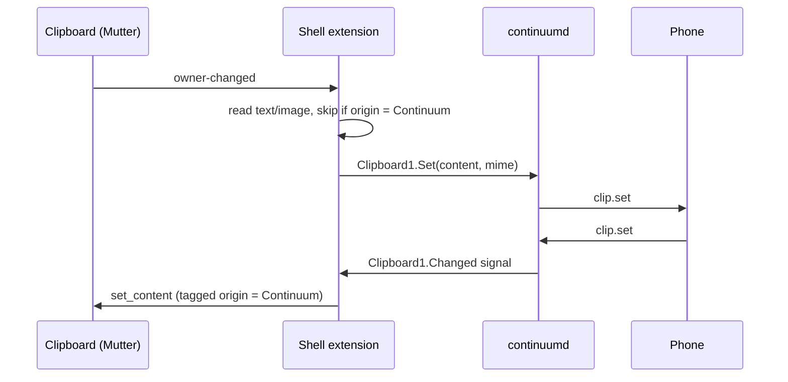

# 04. Desktop integrations (Nautilus, GNOME Shell)

Covers: FR-FILE-6, FR-CLIP-1, 3, FR-SET-2. Decisions: ADR-0004, 0010.

Both are **thin clients**: no protocol logic, no keys, just D-Bus calls to `continuumd`. If the
daemon is missing, they hide their entries instead of showing errors.

## Nautilus extension (`desktop/nautilus/`)
- Python, using `nautilus-python` (the standard way to add file-manager menu entries).
- `get_file_items()` asks the daemon for `ListDevices()` (cached, refreshed on `DeviceChanged`)
  and adds one entry per paired device: **"Send to ⟨name⟩"** with the device's icon. Disconnected
  devices are shown greyed out.
- Activation calls `SendFiles(id, paths)` and returns immediately. Progress appears in the
  daemon's notifications.

## GNOME Shell extension (`desktop/shell-extension/`)

- Clipboard bridge: as above. Loop prevention uses a content hash and origin tag (FR-CLIP-5).
- Quick-settings tile: device name, battery, connected state, and toggles for "Send clipboard"
  and "Mirror".
- Kept as small as possible because GNOME's extension API changes between releases. Supports
  the current and previous GNOME versions.

## Tests
- Nautilus: unit test the menu builder against a fake D-Bus service.
- Shell: lint with ESLint (GNOME config). Manual test in a nested GNOME Shell session.
