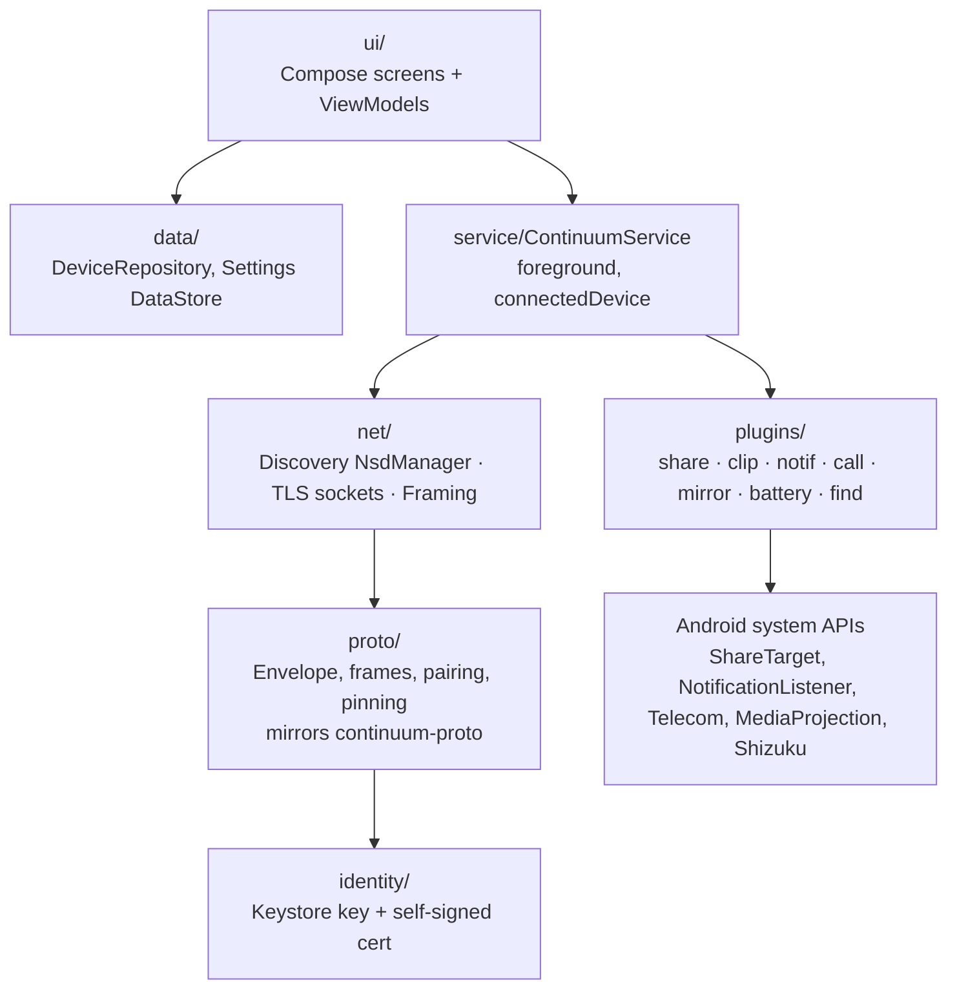

# 05. Android app

Covers: FR-CON-1…5, FR-PAIR-*, FR-FILE-1, 8, FR-CLIP-*, FR-NOTIF-*, FR-CALL-*, FR-MIR-*, NFR-USE-*. Decisions: ADR-0003, 0005, 0008, 0009.

## Purpose
The phone side: a background service that keeps the connection to paired desktops, plus a
Compose UI for pairing, settings and guided setup.

## Package structure (`io.github.sharjeelmazhar.continuum`, see ADR-0013)

| Package | Responsibility |
|---|---|
| `proto` | Same types, framing limits, SAS/HMAC as the Rust crate. Tested with the shared test vectors. |
| `identity` | Key pair in the Android Keystore (never leaves the device). Self-signed cert. |
| `net` | NsdManager discovery, TLS 1.3 sockets with a pinned-fingerprint `X509TrustManager`, reconnect with backoff. |
| `service` | Foreground service (`foregroundServiceType="connectedDevice"`) that owns connections and plugins. Started at boot and by the app. |
| `plugins` | One class per feature implementing a `Plugin` interface (same shape as the desktop's). |
| `ui` | Compose + Material 3 (dynamic colour). Screens: Welcome/Scan QR, Devices, Device detail, Setup guides (battery, Shizuku, notification access). |

## Permissions (asked when pairing, each with a plain-language reason)
| Permission | Why | If denied |
|---|---|---|
| Camera | Scan the pairing QR code | Use the system camera (opens the link, confirmed in-app) |
| Nearby devices (`ACCESS_LOCAL_NETWORK`, Android 17+) | Talk to the computer on the same Wi-Fi | Clear message; retries when the app is opened |
| Notifications (Android 13+) | Show the quiet connection-status notification | Works anyway, status only in the app |
| Battery optimization exemption | Stay connected with the app closed | Works, but the system may pause it |

## Reconnect strategy (seamless, battery-friendly)
- No network: no attempts at all; the network callback wakes the loop when one appears.
- On a network: retry with backoff 1 → 60 s. Saved addresses first, then mDNS lookup by device
  id (address changed); a new address is saved only after the pinned TLS handshake succeeds.
- The desktop's UDP "wake" nudge on startup, opening the app, and boot/app-update all retry at once.

## Background survival
- Foreground service with a quiet, low-priority persistent notification (Android requires one).
- Battery-optimization exemption requested with a plain-language explanation.
- Vendor guides (MIUI/HyperOS, Samsung, etc.) with deep links into the right settings page.

## Share sheet (M4)
Each paired PC is published as a **sharing shortcut** (`ShortcutManagerCompat.pushDynamicShortcut`
with a share-target category), with the PC's name and a laptop or desktop icon, so it appears
in the Direct Share row.

## Tests
- JUnit for `proto` (shared vectors), plugin logic and ViewModels.
- Instrumented tests on the emulator for the service and discovery.
- Interop: app on the emulator ↔ `continuumd` on the host (see doc 07).
