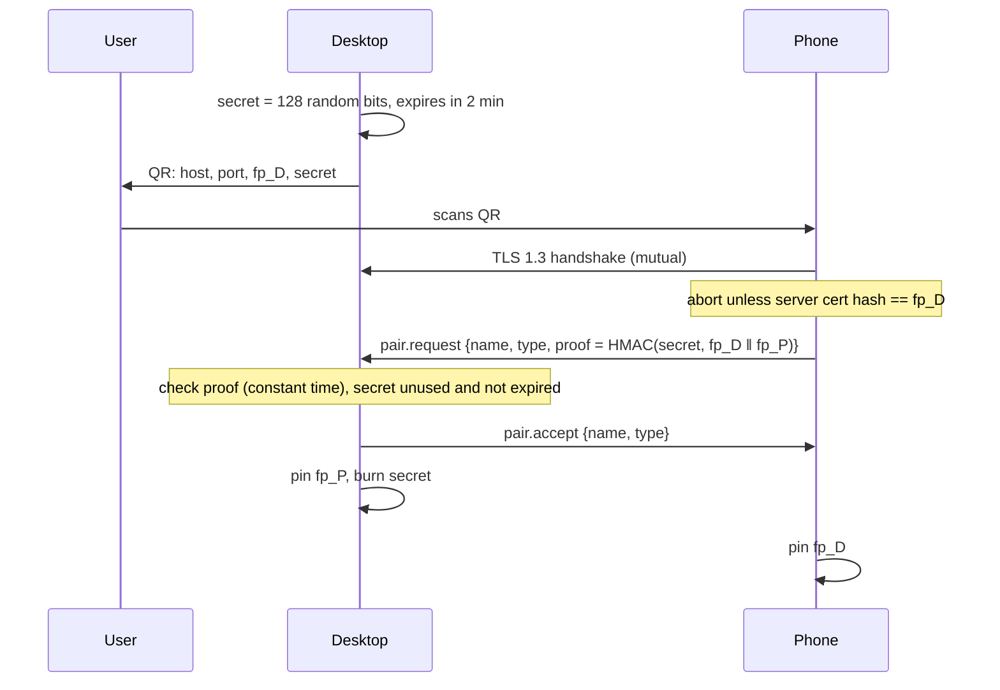

# 06. Security design and threat model

Covers: NFR-SEC-*, FR-PAIR-*. Decisions: ADR-0005, 0007.

## Assets
Device private keys · pinned peer fingerprints · file contents · clipboard · notifications and
messages · call metadata · screen contents and input control (mirroring).

## Attackers considered
| Attacker | Can | Must not be able to |
|---|---|---|
| A1: someone on the same Wi-Fi | sniff, inject, spoof mDNS, connect to the port | read or change traffic, pair, impersonate a paired device |
| A2: malicious app on the phone | use public Android APIs | read Continuum's keys or traffic (app sandbox + Keystore) |
| A3: another local user on the PC | use their own session | reach our D-Bus (session bus is per user), read our keys (`0600`) |
| A4: buggy or malicious peer after pairing | send any bytes | crash the daemon, write outside the download folder, exhaust memory |

Out of scope: an attacker with root on either device, or physical access to an unlocked device.

## Pairing via QR

Why this is safe against A1: the QR code is seen only by the user. The phone checks `fp_D`, so a
fake desktop fails. The desktop checks the proof, which needs the secret, so a fake phone fails.
Binding both fingerprints into the proof stops relaying.

## Pairing via 6-digit code (no camera)
Both sides compute `SHA-256(fp_D ‖ fp_P ‖ nonce) mod 10^6` after the TLS handshake. An attacker in
the middle would hold different certificates, so the codes would differ. The user must confirm
on **both** screens. A 1-in-a-million guess is acceptable with the rate limit (NFR-SEC-7).

## Controls checklist
| Threat | Control |
|---|---|
| Eavesdropping, tampering | TLS 1.3 only, AEAD ciphers (rustls defaults) |
| Impersonation | Mutual TLS, pinned fingerprints, no trust-on-first-use |
| Memory exhaustion | 1 MiB frame cap checked before allocation. Bounded queues. Max concurrent transfers per peer. |
| Path traversal | `filename::sanitize`. Writes only inside the download directory, `O_NOFOLLOW`/`openat`. |
| Brute-force pairing | 5 failures per minute per IP. Secrets single-use, 2 min lifetime. |
| Data-channel hijack | One-time 128-bit token, tied to the control session, expires after 60 s if unused |
| Key theft | `0600` files in a `0700` dir (desktop). Android Keystore, not exportable. |
| Notification leaks | Allowlist empty by default. Optional hide-content-while-locked. |
| Supply chain | `cargo-deny` / `cargo-audit` and Gradle dependency verification in CI (M11) |

## Review points
Every milestone that touches networking adds its new inputs to this table and gets a
security-focused review before it's marked done.
