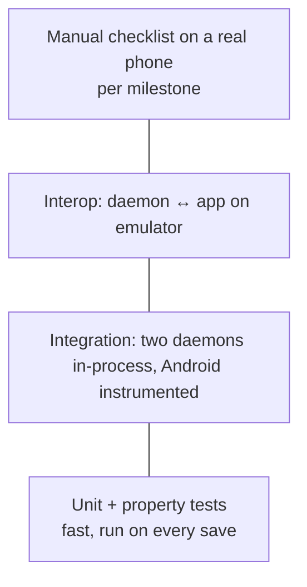

# 07. Build, test and CI

Covers: NFR-MNT-3, SRS §5.

## Developer setup
`scripts/setup-dev.sh` installs everything on Ubuntu/Debian and is safe to re-run: system
packages (GTK4, libadwaita, GStreamer, JDK 21), Rust stable with clippy and rustfmt, the Android
SDK (platform, build-tools, emulator, x86_64 system image) and the `continuum-test` AVD.
Flags: `--no-apt`, `--no-avd`, `--profile`.

## Commands
| What | Command |
|---|---|
| Desktop build / test / lint | `cd desktop && cargo build && cargo test && cargo clippy --all-targets -- -D warnings && cargo fmt --check` |
| Android build / unit tests | `cd android && ./gradlew assembleDebug testDebugUnitTest` |
| Start emulator (headless) | `scripts/emulator.sh` (add `--window` to see it) |
| Install app on emulator or phone | `cd android && ./gradlew installDebug` |

## Emulator networking
The emulator sits behind its own NAT: from inside it, the host is `10.0.2.2`, and multicast (mDNS)
from the host doesn't reach it. For interop tests:
- **Phone → desktop:** the app connects to `10.0.2.2:47820` (the QR code in tests carries this host).
- **Desktop → phone:** `adb reverse`/`adb forward` maps ports when needed.
- mDNS discovery itself is tested on a real phone. On the emulator it's covered by unit tests
  with a fake `NsdManager`.

## Test pyramid

## CI (GitHub Actions, `.github/workflows/ci.yml`)
| Job | Runs on | Steps |
|---|---|---|
| `desktop` | ubuntu-latest | apt GTK4/libadwaita dev, `cargo fmt --check`, `clippy -D warnings`, `cargo test` |
| `android` | ubuntu-latest | JDK 21, Gradle cache, `assembleDebug`, `testDebugUnitTest`, `lint` |

Emulator tests run locally for now (CI emulators are slow and flaky). They may move to CI later.
